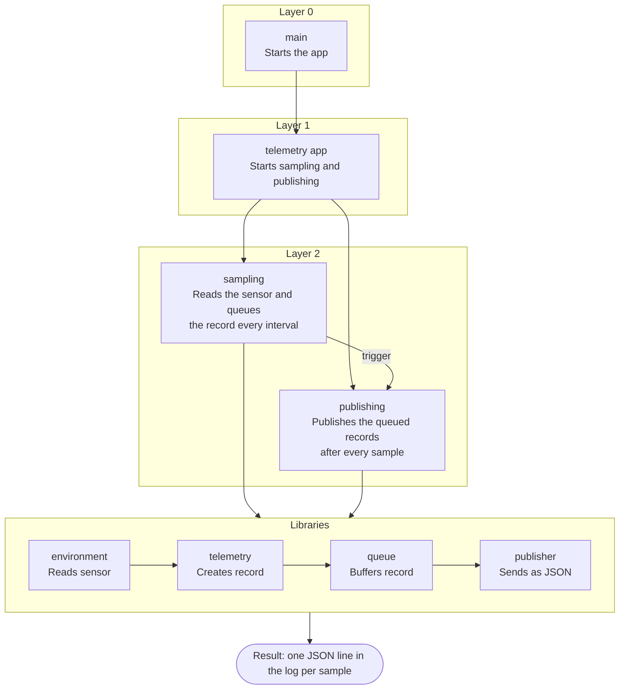
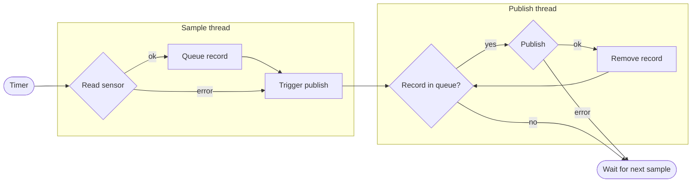

# Software Architecture

This document describes how the telemetry application is built. Read it from
the top: each section goes one level deeper.

## 1. What the application does

At a fixed, configurable interval the application:

1. reads temperature and humidity from the sensor,
2. stores the reading as a telemetry record in a queue,
3. publishes the queued records, oldest first, as JSON.

A record stays in the queue until it has been published. If publishing fails,
the record is kept and tried again the next time a publish runs. If the queue
is full, the oldest record is discarded to make room for the new one.

`main()` only starts the application. Everything else happens in the
telemetry app library.

## 2. Design principles

The application is built in abstraction layers, and every layer talks to the
one below it through an interface. The application logic does not depend on
any particular hardware:

- **The sensor is behind an environment interface.** The application only
  sees a reading with temperature and humidity. It does not know which sensor
  produced it, how the sensor is connected or how it is read.
- **The output is behind a publisher interface.** The application hands over
  a telemetry record. It does not know whether the record ends up in the log,
  on an MQTT broker or somewhere else.
- **The implementation is chosen at build time** with Kconfig, not in the
  code. One option selects the sensor, for example the fake sensor, and
  another selects the publisher, for example the logger publisher.

To use another sensor, implement the environment interface for it and select
it in the project configuration. To publish somewhere else, implement the
publisher interface. The application, the queue and the threads stay the
same. The same applies to boards: the same application code runs on
`native_sim`, QEMU and the Seven board, since nothing in it depends on the
board.

One sensor and one publisher are used at a time, chosen at build time. Using
several sensors at once would need the sensor interface to be extended, for
example with a handle for each sensor.

## 3. Layers

The code is split into layers. Each layer only uses the layer below it, and
each layer can be understood without reading the layers under it.



Example of a published record in the log:

```
<inf> publisher_log: {"seq":0,"uptime_ms":10,"temperature_mc":21500,"humidity_mpct":45000}
```

> **More will come when MQTT is implemented.** An MQTT publisher will be
> added to the libraries as another implementation of the publisher interface, so
> the result becomes a message on an MQTT broker instead of a line in the log.
> Sampling stays the same. Publishing gets connection handling, and a record
> is removed from the queue only after the broker has acknowledged it.

| Layer | Component | Responsibility |
|---|---|---|
| 0 | main | Start the application |
| 1 | telemetry app | Starts publishing and sampling |
| 2 | sampling | Owns the timer and the sample thread. Every interval it reads the sensor, adds the record to the queue and triggers a publish |
| 2 | publishing | Owns the publish thread. After every sample it publishes the queued records, oldest first, and removes each one after it was published |
| Libraries | environment, telemetry, queue, publisher | The building blocks a record passes through: the sensor reading becomes a record, waits in the queue and is published as JSON |

Only the telemetry app interface is public. Sampling and publishing are
private to the library.

In sampling and publishing, the thread code only decides **when** a step
runs. The step itself, taking a sample or publishing the queue, is a function
of its own next to it. That is not a layer of its own: it lets the tests run
each step directly, without threads or timers.

### Libraries

| Library | Interface | Does |
|---|---|---|
| environment | Read a sensor value | Reads temperature and humidity. The fake implementation returns fixed values |
| telemetry | Create and encode a record | Creates a record with sequence number and uptime, and encodes it as JSON |
| queue | Add, peek, remove by sequence number, count, reset | Fixed size FIFO. Discards the oldest record when full |
| publisher | Publish a record | Sends one record. The logger implementation encodes it as JSON and writes it to the log |

## 4. One sample, step by step



## 5. Threads and synchronization

| Thread | Priority | Role |
|---|---|---|
| sample workqueue | Higher | Takes a sample every interval |
| publish workqueue | Lower | Publishes the queued records |

The sample thread has a higher priority than the publish thread, so a
publish that is in progress or blocks does not hold up sampling. A sample can
still wait briefly for the queue lock.

All kernel objects are allocated statically at build time. Starting the
application starts the two threads, publishing first.

The two threads share the telemetry queue. Every operation that changes the
queue holds a lock, and reading the queue is protected by the message queue
itself. This way the sample thread and the publish thread can never change
the queue at the same time, and a thread that reads the queue never sees a
half-written record.

## 6. Failure handling

| Failure | Behavior |
|---|---|
| Sensor read fails | No record is added. A publish is still triggered, so older records are retried. Logged as a warning |
| Publish fails | The record stays in the queue and is published again with the next sample. Logged as a warning |
| Queue full | The oldest record is discarded. The queue always holds the newest records. Logged as a warning |
| Publish blocks | Sampling continues on its own thread and fills the queue. When the queue is full, the oldest records are discarded |
